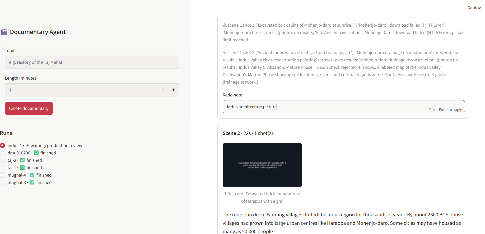
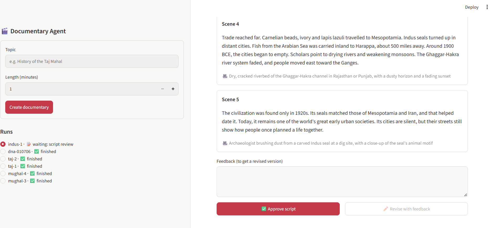
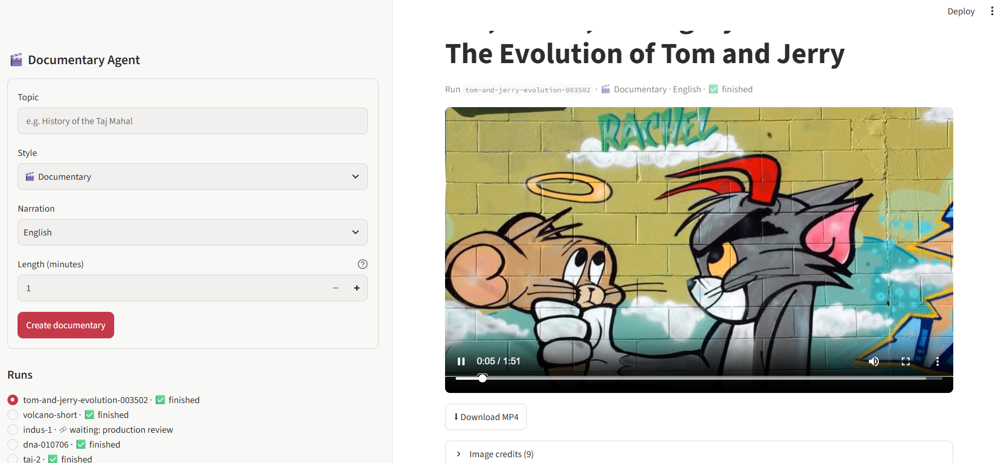
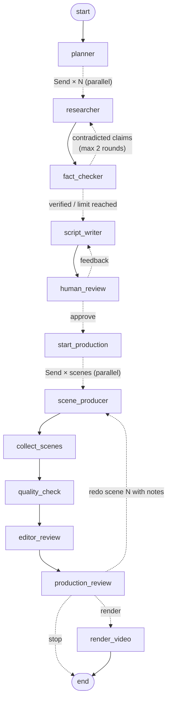
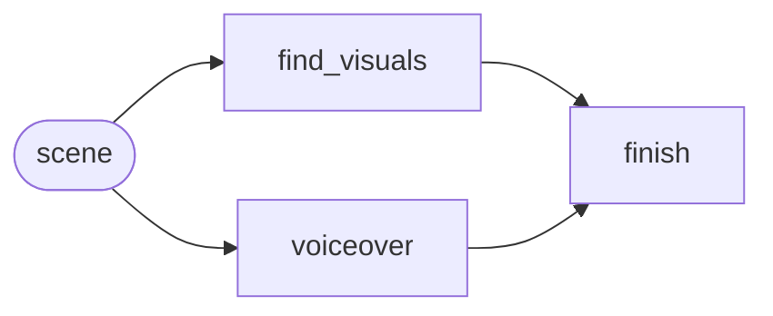

# 🎬 Documentary Agent

A multi-agent system built with **LangGraph** that turns any topic into a narrated documentary video. It researches the topic, fact-checks its own findings, writes a script, finds openly licensed images that match the narrator's words, records a voiceover, and renders an MP4. A human director approves the script and the finished scenes before anything is final.

It works in English and Urdu, in three styles (documentary, kids, vertical short), from the command line or a Streamlit web app. Its media tools are also published as an **MCP server**, so Claude Desktop or any other MCP app (including a LangGraph agent) can use them.

> **Status:** all 8 stages complete. See the [roadmap](#roadmap).

**Example output:** [a 1-minute script on Mughal architecture](examples/script.md), rewritten for kids using time travel.




---

## How it works



Each `scene_producer` is a **subgraph** that runs two branches in parallel and joins them:



| Node                  | What it does                                                                                                                       | Type                   |
| --------------------- | ---------------------------------------------------------------------------------------------------------------------------------- | ---------------------- |
| **planner**           | Splits the topic into 3–5 subtopics in story order                                                                                 | LLM, structured output |
| **researcher**        | Searches the web for one subtopic and extracts sourced facts. One copy per subtopic, **in parallel**                               | Fixed workflow + LLM   |
| **fact_checker**      | A ReAct agent that **chooses its own tools** (Wikipedia or web search) and labels claims _confirmed_, _contradicted_, _unverified_ | Autonomous agent       |
| **script_writer**     | Writes scenes in the chosen style and language. Hedges unverified claims and avoids contradicted ones                              | LLM, structured output |
| **human_review**      | **Pauses the graph** until the director approves the script or gives feedback                                                      | Human-in-the-loop      |
| **scene_producer**    | Subgraph: plans shots tied to words in the narration, finds and visually verifies images, records the voiceover                    | Subgraph, parallel     |
| **quality_check**     | Code checks: missing audio, broken images, one image held too long, a different voice than planned                                 | Deterministic          |
| **editor_review**     | An editor agent that **looks at the images** with a vision tool (limited budget) and suggests up to 3 scene redos                  | Autonomous agent       |
| **production_review** | Pauses again: render, stop, or redo chosen scenes with notes                                                                       | Human-in-the-loop      |
| **render_video**      | Ken Burns moves, crossfades and image credits, rendered to MP4 with live progress                                                  | Deterministic          |

## Features

- **Parallel research and production** with the Send API, for subtopics and for scenes
- **Self-correcting fact-check loop**, limited to 2 rounds, with a fallback when the limit is reached
- **Images matched to the narration:** each shot is anchored to a word in the narrator's sentence and appears when it is spoken. A vision model checks every image before it is used. History topics prefer artwork over modern photos.
- **Openly licensed images only** (Openverse), with a full credits list in the manifest and on screen
- **Voiceover with edge-tts:** a voice chosen per topic, documentary pacing, retries in the same voice before any fallback
- **Two review points:** approve or revise the script; then render, stop or redo individual scenes with notes
- **An editor agent** that reviews the scenes and pre-fills redo suggestions, which you can accept with one key
- **Styles:** documentary, kids, and a 1-minute vertical (9:16) short
- **Languages:** English and Urdu (Urdu-script narration, right-to-left display in the app)
- **Persistence and time travel:** stop at any point and resume later; rewind a run and make a new version without repeating research
- **Live progress** in the terminal and the web app, including a render progress bar
- **MCP server:** image search, download, narration and rendering, available to any MCP client
- **Provider-agnostic:** Anthropic, OpenAI, Groq or Gemini, by changing one environment variable

## LangGraph concepts used

| Concept                                                                    | Where                                                                             |
| -------------------------------------------------------------------------- | --------------------------------------------------------------------------------- |
| `Send` API (dynamic fan-out)                                               | parallel researchers and scene producers; re-research of weak subtopics only      |
| Custom reducers                                                            | `merge_research` and `merge_scenes` **replace** an old entry instead of appending |
| `operator.add` reducer                                                     | collecting unverified claims across rounds                                        |
| Conditional edges and cycles                                               | the research ↔ fact-check loop, with a round limit                                |
| Agents as nodes                                                            | `create_agent` with tools and a `response_format` (fact-checker, editor)          |
| Tools built per run, budget enforced in code                               | the editor's `look_at_shot` vision tool                                           |
| Subgraph as a node, with `output_schema`                                   | the scene producer, with two parallel branches and a join                         |
| `RetryPolicy`                                                              | retrying a scene after a network error                                            |
| `interrupt()` + `Command(resume=...)`                                      | both review points, labeled by `type`                                             |
| `Command(goto=..., update=...)`                                            | review nodes route themselves; `Command(goto=[Send(...)])` redoes chosen scenes   |
| `SqliteSaver` checkpointer + `thread_id`                                   | persistence across restarts, many independent runs                                |
| `get_state_history` + `update_state`                                       | time travel: branching from a past checkpoint                                     |
| `get_stream_writer` + `stream_mode=["updates","custom"]`, `subgraphs=True` | live progress from inside nodes and subgraphs                                     |
| Reading `RunnableConfig` in a node                                         | per-run output folders                                                            |
| MCP tools via `langchain-mcp-adapters`                                     | `mcp_agent.py`: an agent whose only tools come from the MCP server                |

## Design decisions

- **The LLM classifies; code decides.** The fact-checker only labels claims, and code decides which subtopics are weak. The editor suggests redos, and code checks that they name real scenes, are not duplicates, and number at most 3. Prompts are suggestions; structure is enforced.
- **Never trust identifiers from an LLM.** Subtopics and scenes are referred to by number, and code maps them back, ignoring invalid ones.
- **A retry limit needs a fallback.** If fact-checking runs out of rounds, the remaining corrections go to the script writer as "do not use these claims". If a voice keeps failing, the scene uses another voice in the same language and is flagged for review.
- **Agentic only where it adds value.** Research and production are fixed workflows; fact-checking and editing are agentic, because choosing how to verify a claim or which image to inspect is a real decision.
- **Catch only the errors you expect.** Voiceover catches network and TTS errors only, so real bugs are not hidden behind a fallback.
- **Runtime context is not checkpointed.** Style and language live in the state, so a resumed run keeps them.
- **Errors are information.** A failed search or tool call returns a message instead of crashing, so the agent can try another way.

## Setup

Requires Python 3.11+.

```bash
git clone https://github.com/aroomahameed/documentary-agent.git
cd documentary-agent
python -m venv .venv
.venv\Scripts\activate            # Windows
# source .venv/bin/activate       # macOS / Linux
pip install -r requirements.txt
```

Create a `.env` file in the project root:

```
MODEL=anthropic:claude-haiku-5-5
ANTHROPIC_API_KEY=your-key
TAVILY_API_KEY=your-key           # free tier at tavily.com

# Optional
VIDEO_HEIGHT=1080                 # use 480 for fast previews
EDITOR_ENABLED=true               # set false to skip the editor agent
OPENVERSE_EXCLUDE=wikimedia       # image sources to skip (see Known limitations)
TTS_VOICE=en-US-AndrewNeural      # force a voice
LANGSMITH_TRACING=true            # tracing in LangSmith
LANGSMITH_API_KEY=your-key
LANGSMITH_PROJECT=documentary-agent
```

To use another provider, change `MODEL` (e.g. `openai:gpt-4o-mini`) and install its LangChain package.

## Usage

### Web app

```bash
streamlit run app.py
```

Start a run from the sidebar (topic, style, language, minutes), watch progress live, review the script, check every scene in a gallery, redo scenes with notes, and watch or download the finished video.

### Command line

```bash
# Start a new run. It pauses for script review and again for scene review.
python main.py "History of Mughal architecture" --thread mughal-1

# Other styles and languages
python main.py "How volcanoes work" --style kids --thread volcano-1
python main.py "Fatehpur Sikri" --style short --language ur --thread sikri-1

# Resume a paused or interrupted run
python main.py --thread mughal-1

# List every saved checkpoint of a run, or rewind and make a new version
python main.py --thread mughal-1 --history
python main.py --thread mughal-1 --fork "Rewrite it for 10-year-old kids"

# Print the graph as a Mermaid diagram
python main.py --draw
```

Options: `--minutes N` (default 1), `--style documentary|kids|short`, `--language en|ur`.

At the scene review, press **Enter** to render, **a** to accept the editor's suggestions, `redo 3: closer view of the gate; 5: show a painting` to redo scenes, or `stop`.

Output goes to `output/<topic>-<thread>/`: `script.json`, a `media-*` folder with images, audio and `manifest.json` (including credits), and the final MP4.

### MCP

```bash
python mcp_client_demo.py        # a plain MCP client: lists tools and calls them
python mcp_agent.py              # a LangGraph agent that uses only the MCP tools
python mcp_agent.py "Find 2 artworks of Akbar's court and narrate one line about them in Urdu"
```

Tools: `search_images`, `download_image`, `list_voices`, `narrate`, `render_video` (with progress), plus the resource `documentaries://videos`. Files are written only inside `output/`.

To use it in Claude Desktop, add this to its config (Settings → Developer → Edit Config), with your own paths:

```json
{
  "mcpServers": {
    "documentary-tools": {
      "command": "D:\\path\\to\\documentary-agent\\.venv\\Scripts\\python.exe",
      "args": ["D:\\path\\to\\documentary-agent\\mcp_server.py"]
    }
  }
}
```

## Project structure

```
doc_agent/
  state.py       # Pydantic models (LLM outputs), graph state, reducers
  prompts.py     # all prompts in one place
  llm.py         # provider-agnostic model loader (MODEL env var)
  tools.py       # web search + Wikipedia tools
  nodes.py       # main graph nodes and routing
  production.py  # scene subgraph: shot planning, image search and checks, voiceover
  editor.py      # editor agent with a vision tool
  media.py       # Openverse search, downloads, edge-tts
  video.py       # Ken Burns rendering with moviepy
  styles.py      # documentary, kids, short
  languages.py   # English and Urdu
  runs.py        # checkpointer, run status, time travel helpers
  graph.py       # wiring: nodes and edges
main.py          # CLI
app.py           # Streamlit web app
mcp_server.py    # MCP server (FastMCP, stdio)
mcp_client_demo.py
mcp_agent.py     # LangGraph agent using the MCP tools
examples/        # sample output
tests/           # offline tests with fake LLM, media and TTS (67 tests)
LEARNINGS.md     # what I learned at each stage
```

Run the tests with `python -m pytest -q`. They need no API keys.

## Roadmap

- [x] **Stage 1: Research → Script.** Parallel research with the Send API and reducers
- [x] **Stage 2: Fact-checking loop.** A ReAct agent with tools, cycles with limits, a custom reducer
- [x] **Stage 3: Human review and persistence.** `interrupt`, checkpointer, resume, time travel
- [x] **Stage 4: Scene production.** A subgraph per scene: find visuals, generate voiceover (`edge-tts`)
- [x] **Stage 5: Assembly.** Quality check, scene review with redo, render the video (`moviepy`)
- [x] **Stage 6: UI.** Live progress streaming in a Streamlit web app
- [x] **Stage 7: Multi-agent and styles.** An editor agent, style presets, English + Urdu narration
- [x] **Stage 8: MCP.** The media tools as an MCP server, used by Claude Desktop and by a LangGraph agent

## Known limitations

- The fact-checker is an LLM too and can make its own mistakes (in one run it wrongly "corrected" the Taj Mahal's location). It improves accuracy but doesn't guarantee it.
- Sources that disagree on small details (e.g. distances) are sometimes still flagged as contradictions.
- Image quality depends on what free libraries hold. Some topics have few good images, and the result is better with an artwork-heavy subject than a modern one.
- Some networks block Wikimedia, even through Openverse. `OPENVERSE_EXCLUDE=wikimedia` (the default) skips it; set it to empty if Wikimedia works for you, since it has many good historical images.
- Openverse's anonymous limit is about 20 requests a minute and 200 a day. Results are cached in `.cache/`.
- The Urdu voices work only at normal speed and pitch, and their pronunciation is weaker than the English voices.
- edge-tts uses an unofficial online service and sometimes fails; the agent retries and then falls back to another voice.

## Tech stack

LangGraph · LangChain · Claude (Anthropic) · Tavily Search · Wikipedia API · Openverse · edge-tts · moviepy · Pillow · Streamlit · MCP · SQLite · Pydantic
