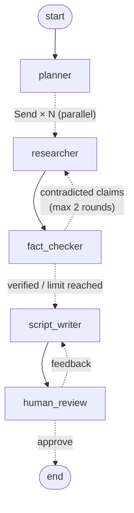

# 🎬 Documentary Agent

A multi-agent system built with **LangGraph** that researches any topic, fact-checks its own findings, and writes a narrated documentary script, with a human director approving every script before it's final.

> **Status:** Stages 1–3 of 8 complete (research → fact-check → script → human review, with persistence and time travel). Video production (visuals, voiceover, rendering) is next. See the [roadmap](#roadmap).

**Example output:** [a 1-minute script on Mughal architecture](examples/script.md), rewritten for kids using time travel.

---

## How it works



| Node              | What it does                                                                                                                                                 | Type                   |
| ----------------- | ------------------------------------------------------------------------------------------------------------------------------------------------------------ | ---------------------- |
| **planner**       | Splits the topic into 3–5 subtopics in story order                                                                                                           | LLM, structured output |
| **researcher**    | Searches the web for one subtopic and extracts sourced facts. One copy runs per subtopic, **in parallel**                                                    | Fixed workflow + LLM   |
| **fact_checker**  | A ReAct agent that **chooses its own tools** (Wikipedia or web search) to verify key claims, and labels each one _confirmed_, _contradicted_ or _unverified_ | Autonomous agent       |
| **script_writer** | Writes scenes (narration + visual description + sources). Hedges unverified claims and avoids contradicted ones                                              | LLM, structured output |
| **human_review**  | **Pauses the graph** and waits for the director to approve or give feedback                                                                                  | Human-in-the-loop      |

Contradicted claims send only the affected subtopics back for re-research, with the fact-checker's corrections attached. Every step is saved to SQLite, so a run can be stopped and resumed at any time, or rewound to an earlier point to create a different version.

## Features

- **Parallel research** with the Send API: all subtopics are researched at the same time
- **Self-correcting loop:** the fact-checker sends weak research back, limited to 2 rounds
- **Autonomous tool use:** the fact-checker decides which tool to call and when
- **Human-in-the-loop review:** approve the script, or type feedback and get a revision
- **Persistence:** kill the program at any point and resume the same run later, without repeating work
- **Time travel:** rewind a finished run to just after research and generate a new version (e.g. "for kids") without paying for research again
- **Provider-agnostic:** works with Anthropic, OpenAI, Groq or Gemini by changing one environment variable

## LangGraph concepts used

| Concept                                  | Where                                                                                |
| ---------------------------------------- | ------------------------------------------------------------------------------------ |
| `Send` API (dynamic fan-out)             | planner → parallel researchers; fact-checker → re-research of weak subtopics only    |
| Custom reducer                           | `merge_research` **replaces** a subtopic's old note instead of appending a duplicate |
| `operator.add` reducer                   | collecting unverified claims across rounds                                           |
| Conditional edges and cycles             | the research ↔ fact-check loop, with a round limit                                   |
| Agent as a node                          | `create_agent` with tools and a `response_format` runs inside the main graph         |
| `interrupt()` + `Command(resume=...)`    | pausing for human review and resuming with the decision                              |
| `Command(goto=..., update=...)`          | the review node routes itself and updates state in one return                        |
| `SqliteSaver` checkpointer + `thread_id` | persistence across restarts, many independent runs                                   |
| `get_state_history` + `update_state`     | time travel: branching from a past checkpoint                                        |
| `stream_mode="updates"`                  | live progress in the terminal                                                        |

## Design decisions

- **The LLM classifies; code decides.** Early versions asked the fact-checker which subtopics were "weak". It ignored the prompt's rules and flagged nearly everything, even confirmed facts. Now it only labels each claim, and code decides that a subtopic is weak only if a claim is _contradicted_. Prompts are suggestions; structure is enforced.
- **Never trust identifiers from an LLM.** The fact-checker sometimes invented its own subtopic names. It now refers to subtopics by number, and code maps numbers back to real names, ignoring invalid ones.
- **A retry limit needs a fallback.** Re-research can introduce new errors. If the round limit is reached, the remaining corrections are passed to the script writer as "do not use these claims".
- **Agentic only where it adds value.** Research is a fixed workflow (always search, then summarize), while fact-checking is agentic, because choosing _how_ to verify a claim is a real decision.
- **Errors are information.** A failed search or tool call returns a message instead of crashing, so the run continues and the agent can try another way.

## Setup

Requires Python 3.11+.

```bash
git clone https://github.com/aroomahameed/documentary-agent.git
cd documentary-agent
python -m venv .venv
.venv\Scripts\activate            # Windows
# source .venv/bin/activate       # macOS / Linux
pip install -r requirements.txt
```

Create a `.env` file in the project root:

```
MODEL=anthropic:claude-haiku-5-5
ANTHROPIC_API_KEY=your-key
TAVILY_API_KEY=your-key           # free tier at tavily.com

# Optional: tracing in LangSmith
LANGSMITH_TRACING=true
LANGSMITH_API_KEY=your-key
LANGSMITH_PROJECT=documentary-agent
```

To use another provider, change `MODEL` (e.g. `openai:gpt-4o-mini`) and install its LangChain package (e.g. `langchain-openai`).

## Usage

```bash
# Start a new run. It pauses when the script is ready for your review.
python main.py "History of Mughal architecture" --thread mughal-1

# Resume a paused run (e.g. after closing the program)
python main.py --thread mughal-1

# List every saved checkpoint of a run (newest first)
python main.py --thread mughal-1 --history

# Time travel: rewind to just after research and write a new version
python main.py --thread mughal-1 --fork "Rewrite it for 10-year-old kids"

# Print the graph as a Mermaid diagram
python main.py --draw
```

Options: `--minutes N` sets the target length (default 1).

At the review step, press **Enter** to approve, or type feedback to get a revised script. Approved scripts are saved to `output/<topic>-<thread>/script.md` and `script.json` (forks add `-fork` to the folder name).

## Project structure

```
doc_agent/
  state.py      # Pydantic models (LLM outputs), graph state, custom reducer
  prompts.py    # all prompts in one place
  llm.py        # provider-agnostic model loader (MODEL env var)
  tools.py      # web search + Wikipedia tools
  nodes.py      # graph nodes and routing
  graph.py      # wiring: nodes and edges
main.py         # CLI: run, resume, review, history, time travel
examples/       # sample output
tests/          # offline tests with a fake LLM
LEARNINGS.md    # what I learned at each stage
```

## Roadmap

- [x] **Stage 1: Research → Script.** Parallel research with the Send API and reducers
- [x] **Stage 2: Fact-checking loop.** A ReAct agent with tools, cycles with limits, a custom reducer
- [x] **Stage 3: Human review and persistence.** `interrupt`, checkpointer, resume, time travel
- [ ] **Stage 4: Scene production.** A subgraph per scene: find visuals, generate voiceover (`edge-tts`)
- [ ] **Stage 5: Assembly.** Quality check, preview approval, render the video (`moviepy`)
- [ ] **Stage 6: UI.** Live progress streaming in a web interface
- [ ] **Stage 7: Multi-agent and styles.** A supervisor, style presets, English + Urdu narration
- [ ] **Stage 8: MCP.** Expose the tools as an MCP server

## Known limitations

- The fact-checker is an LLM too and can make its own mistakes (in one run it wrongly "corrected" the Taj Mahal's location). Its findings improve accuracy but don't guarantee it.
- Sources that disagree on small details (e.g. distances) are sometimes still flagged as contradictions.

## Tech stack

LangGraph · LangChain · Claude (Anthropic) · Tavily Search · Wikipedia API · SQLite · Pydantic
